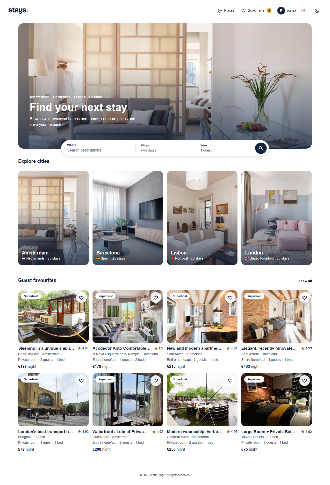
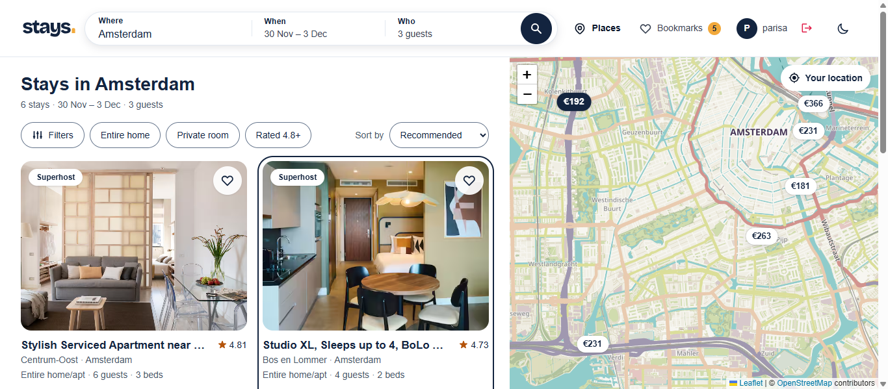
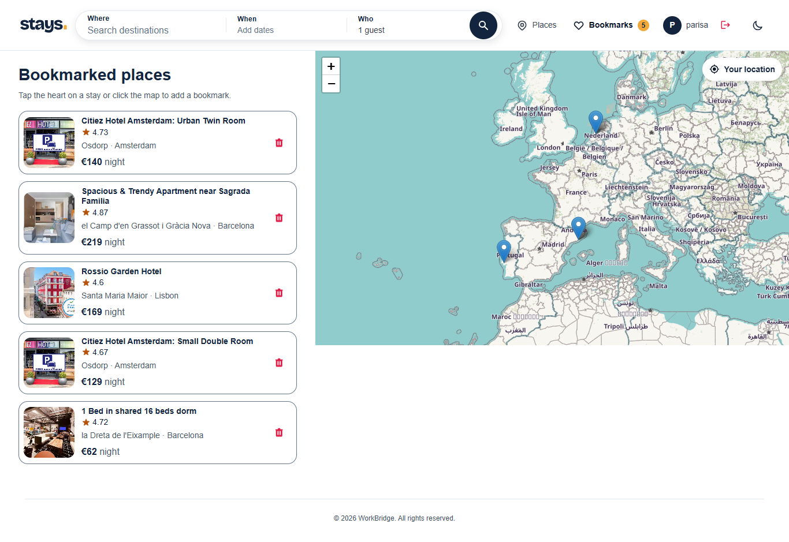

# Stays – Hotel Booking App

A hotel and short-stay discovery app built with React and Vite. Search a destination, filter and sort stays, see them on an interactive map, open the details and save favourites. Map bookmarks and a demo login are included too.

Listing data is a static snapshot from [Inside Airbnb](https://insideairbnb.com/get-the-data/) (CC BY 4.0). **This is a demo:** it does not take bookings, and prices are snapshot prices, not live rates.





## Features

- **Search**: destination combobox, check-in / check-out range and guest steppers. All search state lives in the URL, so results can be shared and reloaded
- **Results**: image-led cards, a list + map split view on desktop, a map toggle on mobile, and price-pill markers (Leaflet)
- **Filters & sorting**: price range, type of place, guest rating, amenities, sort by price or rating, server-side pagination
- **Details**: photo, key facts, highlights, amenities, host, location map and a price card with an estimated total
- **Favourites**: heart any stay; saved stays persist in `localStorage` and are listed on `/saved`
- **Bookmarks**: click the map to bookmark a place, with reverse geocoding and country flags (demo login required)
- **Dark mode** with a header toggle
- **States & accessibility**: skeletons, empty and error states with retry, image fallbacks, visible focus, keyboard-operable popovers and dialogs, mobile bottom navigation

## Tech stack

React 18, React Router 6, Context API + reducers, Axios, React-Leaflet, React-Date-Range, React-Hot-Toast, react-icons, JSON Server, ESLint, and Node's built-in test runner.

## Getting started

```bash
git clone https://github.com/parisa-adli/Stays-Booking-Hotel.git
cd Stays-Booking-Hotel
npm install
npm run dev      # app on http://localhost:5173 + json-server on http://localhost:5000
```

The app reads the API address from `VITE_API_URL` (default `http://localhost:5000`). To use another port, copy `.env.example` to `.env.local` and change it.

**Demo login:** see `src/components/context/AuthProvider.jsx` for the demo email and password.

| Script | What it does |
|--------|--------------|
| `npm run dev` | Client and API together |
| `npm run client` / `npm run server` | Vite only / json-server only |
| `npm run build` / `npm run preview` | Production build and local preview |
| `npm run lint` | ESLint, zero warnings allowed |
| `npm test` | Unit tests (search ↔ URL mapping, CSV import) |
| `npm run data:import` | Rebuild `server/db.json` from Inside Airbnb files |

## Updating the data

1. Download each city's `listings.csv.gz` from the `sourceUrl` values in `scripts/cities.config.json` into `data/raw/<city>/<date>/`.
2. Run `npm run data:import`. It keeps the top 25 listings per city, normalizes them and keeps existing bookmarks.

See `server/ATTRIBUTION.md` for the source, license and transformations.

## Project structure

```
src/
  components/<Name>/   # HotelCard, SearchBar, FilterSheet, Map, SingleHotel, ...
  components/context/  # Auth, Cities, Favorites, Bookmarks and Hotels providers
  hooks/               # useFetch, useDismiss, useMediaQuery, useGeoLocation, ...
  services/            # API client, search ↔ URL ↔ query mapping, formatters (+ tests)
scripts/               # Inside Airbnb import
server/db.json         # json-server data
docs/                  # PRD and design spec
```

## Data & attribution

Listing data © [Inside Airbnb](https://insideairbnb.com/), licensed [CC BY 4.0](https://creativecommons.org/licenses/by/4.0/). Photos are served from Airbnb's CDN. Not affiliated with Airbnb.

## License

MIT
